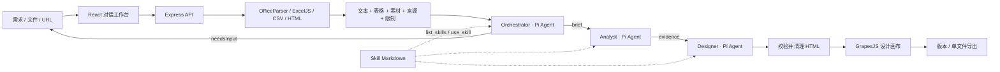

# 实现架构

三个角色由应用串行调度，每个角色是独立的 Pi Agent 实例。没有任意 shell、文件系统工具或模型创建新角色的能力。协调器的 brief 和分析器的结果用 Zod 校验。页面必须包含 html/body，校验失败保留已有版本。停止通过 AbortController 调用 Pi Agent.abort。

项目 JSON 保留原始需求、对话、源资料、分析结果、运行事件和所有 HTML 版本。写入采用同目录临时文件和 rename；进程内运行锁避免相同项目重复生成。素材使用 UUID 名称保存在 workspace/assets，导出时内联实际引用的素材。当前没有数据库、跨进程锁或多实例协调，因此部署保持单进程。

前端在生成期间订阅 SSE，并通过低频轮询同步最终持久状态。断开浏览器不会丢失后台生成。手动编辑必须明确保存，后续模型修订读取最新版本。历史恢复创建新版本，旧版本仍保留。

需求澄清只在协调器返回 needsInput=true 时暂停；UI 展示 question，下一条用户消息会连同已有对话重新进入流程。文档与网页视为不可信证据；只有本地配置的角色和 Skill 文件进入工具指令层。

固定预算控制输入规模：100k 来源字符，单来源最多 25k、每表 100 行、最多 8 张小于 4 MB 的图像、最近 16 条消息。后续可扩展分块检索，当前通过来源限制信息告知模型内容不完整。

## 配置与执行边界

模型配置使用 Pi provider 目录生成下拉选项，PUT `/api/config` 校验后原子写入权限 0600 的 `workspace/settings.json`，仅返回 hasApiKey 标记。默认供应商使用通用密钥，跨供应商角色覆盖使用其供应商环境变量；兼容端点共用已配置的端点与密钥。配置写入和活动生成互斥，后续任务读取新设置。配置启动加载失败会明确报错，避免静默回退。

Skill 发现调用 Pi 官方 `loadSkillsFromDir`，宿主只补充角色和只读知识权限。`list_skills` 支持 format/task 条件筛选；`use_skill` 返回正文并记录事件。发现诊断位于 `/api/skills/diagnostics`。本地可信目录是唯一 Skill 来源。

不可信文件在限时 45 秒、V8 堆上限 384 MB 的 Worker 中解析。HTTP 服务不被同步 Office/PDF 解析占住，失败文件不会阻止同批其他文件成功导入。上传大小、ZIP 条目和展开体积另有约束；Worker 并非 OS 文件系统沙箱，解析器仍是受信任依赖。

页面使用 HTML 标签/属性白名单、素材 URL 约束、CSP 和不含 allow-scripts 的 iframe sandbox；GrapesJS 重建画布后恢复 CSP。只开放 HTML/CSS 及原生浏览器交互，不执行生成脚本。编辑器保留页面标题、语言与描述。版本保存携带 baseVersionId 检查多标签页冲突；单项目文件写入串行化并通过 rename 原子提交。

模型输出按契约解析，并验证 facts.sourceId 及 assets 的实际来源。验证失败允许一次同角色定向修复，再失败则记录错误，不覆盖旧版。取消、超时和工具轮数都有边界，最终释放运行锁。来源警告、分析摘要与事实来源可在对话和资料弹层检查。

## 配置协议更新

当前 `/api/config` 使用 `language`（zh/en）、`mode`（live/demo）和 `models`。models 包含 reasoning、analyst、designer；后两项为 null 时完整继承 reasoning，否则独立配置模式、URL、名称、密钥和视觉支持。OpenAI 使用 Responses，兼容型使用 Chat Completions，不依赖预设模型目录。旧扁平配置在加载时迁移。读取接口只返回 hasApiKey，密钥不会发送给前端。设置样式直接复用 Dreamatic CSS 规则，界面语言在保存后同步并持久化。

## 受控项目工具

角色工具注册于 packages/agents/src/tools.ts；source-content.ts 保存完整分块提取，pages.ts 管理候选稿与结构验证，page-preview.ts 负责隔离渲染。三角色共享项目上下文、来源读取/搜索和素材检查；table_query 仅 Analyst，页面验证/预览/补丁仅 Designer。每个工具闭包绑定当前 Project，不接受任意磁盘路径。八项工具的协议与边界见 agent-tools.md。

候选稿保存于项目 drafts/，绑定生成时最新 baseVersionId。Designer 可返回 candidateId，宿主读取并重新验证，通过后才生成正式版本。补丁操作要求选择器唯一，任一操作失败不会修改已保存版本。图像、浏览器预览和表格操作都有预算，取消信号传递给浏览器并关闭进程。资料存储警告和 legacySummaryOnly 标记不被隐藏。
